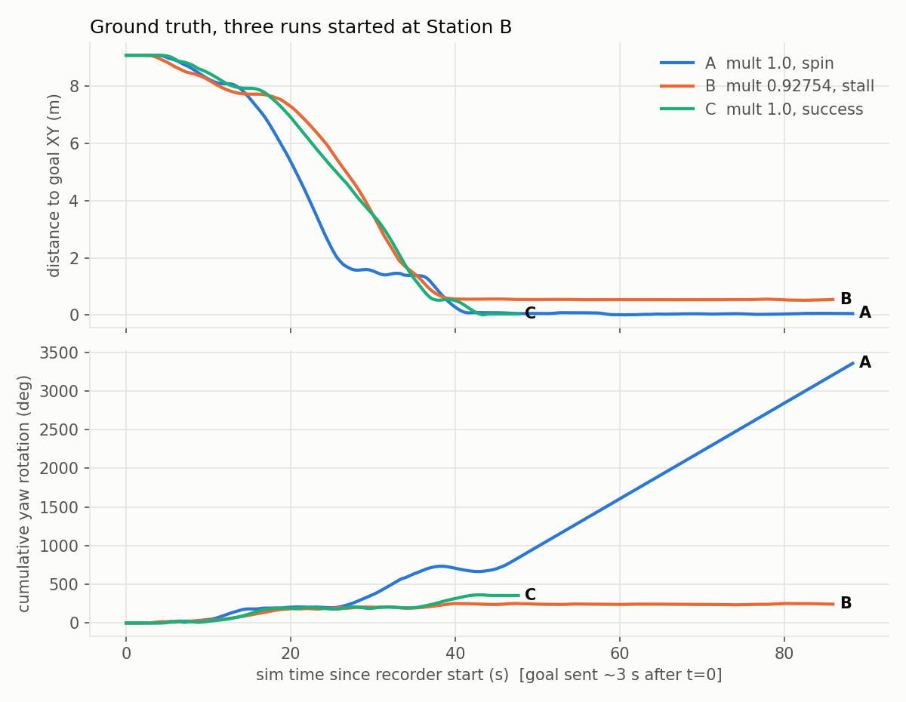
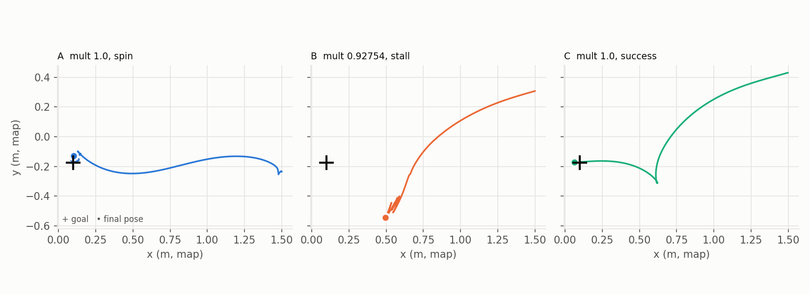

# Warehouse AMR — B → A terminal behaviour: spin / stall / success variability (2026-10-23)

**Project:** Warehouse AMR / `warehouse_amr` (written under the earlier working name "MTS_AMR")  **Branch:** `feature/bidirectional-navigation-baseline` (HEAD `c57e6bd`, working tree dirty, nothing committed)
**Scope:** Re-running the Oct 22 "wheel-separation calibration" B → A comparison for documentation video, and what the repeated runs showed.
**Status of this document:** measurements and logs from 7 simulation runs. No fix was attempted and no configuration was changed.

---

## 1. Summary

The Oct 22 report concluded that the uncalibrated wheel model (`wheel_separation_multiplier: 1.0`) causes a sustained ~1 rad/s spin on B → A and that the calibrated value (`0.92754`) fixes it (3 of 3 successes). Re-running both configurations today produced **a more mixed picture**:

| | multiplier 1.0 (uncalibrated) | multiplier 0.92754 (calibrated) |
|---|---|---|
| Runs today | 4 | 3 |
| Spin | **2** (one far from the goal, one at the goal) | 0 |
| Reached goal (`SUCCEEDED`) | 2 | 1 |
| Did not finish, **no spin** | 0 | **2** (one with data: a stall 0.54 m short of the goal; one with almost no data) |

What the data supports:

1. **The spin is real and has two distinct modes** under the uncalibrated model: a far-field spin right after the goal is sent (run H1, ~8 m out, `cmd_vel` angular pinned at 1.0 rad/s) and a terminal spin at the goal (run B1, ground-truth yaw rate 1.08 rad/s, 3356° of rotation, never converged to yaw).
2. **The spin is not deterministic.** The uncalibrated model also completed B → A twice (H3, B3) with peak commanded yaw rate well below the limit (0.62 rad/s in H3, 0.54 rad/s in B3, from the 1 Hz command traces).
3. **Calibration did not make B → A reliable.** Including the three Oct 22 successes, the calibrated model completed 4 of 6 runs. Of the two non-completions, one was captured well enough to show a **stall**: the robot stopped 0.54 m from the goal, facing about 106° away from it, and did not move for the remaining ~45 sim-seconds. No spin was seen with the calibrated model.
4. **The calibrated stall is a different failure from the spin**, and today's evidence does not explain it.

What the data does **not** support: any statement of failure *rates* (4 and 3 runs per arm; a 95% interval on 4 successes in 6 runs is roughly 22%–96%), or any statement of *cause* for the stall.

---

## 2. Why these runs were made

The owner wanted short videos of (a) the AMR spinning on B → A and (b) the same mission working after the fix. The runs were repeated several times for camera angles. Along the way the behaviour stopped matching the Oct 22 summary, so this report records it.

---

## 3. Test setup

### 3.1 Configuration under test

| Item | Value | Source |
|---|---|---|
| Simulator / stack | Gazebo, `amr_bringup simulation_navigation.launch.py`, ROS 2 Jazzy, Nav2 Smac State Lattice + MPPI DiffDrive | repo |
| Calibrated config | `wheel_separation_multiplier: 0.92754` (uncommitted change in `src/amr_control/config/controllers.yaml`; `install/` symlinks into `src/`) | `git diff`, `params.txt` of each run |
| Uncalibrated config | identical except `wheel_separation_multiplier: 1.0`, loaded at launch from a scratch copy of `controllers.yaml` (a runtime `ros2 param set` is not applied by the controller — see Oct 22 report) | `params.txt` of each run |
| Nav2 params | `src/amr_navigation/config/nav2_params.yaml` unchanged (sha256 prefix `8e4ac952a526104e`; `controllers.yaml` `2cdb5b0f9ef5f713`) | `sha256sum` |
| Relevant Nav2 settings in the file now | `StoppedGoalChecker` xy 0.25 m / yaw 0.20 rad; MPPI `vx_min: -0.35`, `wz_max: 1.0`; lattice `allow_reverse_expansion: true` (bidirectional baseline) | grep of `nav2_params.yaml` |
| Goal | B → A staging pose `(0.099, -0.175, yaw 0)` in `map` | `nav_goal.py`, `stations.yaml` |
| Station B | `(8.716, 2.705, yaw 0)` | `stations.yaml` |

### 3.2 Two start conditions

- **Home start (runs H1–H4):** robot spawns at Home `(-7.589, 1.2)`, is sent Home → B, then B → A (the Oct 22 procedure).
- **B start (runs B1–B3):** robot **spawns at Station B** and the AMCL initial pose is set there; only the B → A goal is sent. This was done with scratch copies of `simulation_navigation.launch.py` that replace the home pose with B. Repo files were not modified. The AMCL pose at start was `(8.716, 2.705)`, yaw 0, in each run (`start_pose.txt`).

The B start is a **different initial condition** from the Oct 22 validation: the robot starts stationary at exactly B's pose, not having arrived from Home with its small residual pose and heading error.

### 3.3 What was recorded

- **No rosbag** (owner's instruction). Disk note: the output went to the scratchpad on `/`.
- `nav_goal.py --no-watchdog` ran the goal and logged a 1 Hz trace of Nav2 feedback pose and the final `cmd_vel` (`b_to_a_result.json`) — **only if the client finished**. A client killed by the wall-clock cap writes no result file.
- B-start runs also recorded Gazebo ground-truth pose (`gt.csv`, ~100 Hz, sim time).
- `launch.log` for every run.
- **Not recorded in any run today:** `/plan`, `/unsmoothed_plan`, `/transformed_global_plan`, `/cmd_vel_nav`, odometry, IMU. For B1 and B2, no commanded velocities either (B3 finished normally, so its result file has the 1 Hz command trace).

### 3.4 Caps, timing

- Each B → A client was limited to 150 s **wall-clock** (`timeout 150`). The simulator ran slower than real time: ground truth covers 85.9–88.3 sim-seconds in a 150 s wall window. By comparing wall and sim durations, real-time factor was roughly 0.54–0.59 (**inferred from wall/sim durations; not measured directly**).
- The watchdog was off for all runs, so spins were not cancelled by software.

---

## 4. Run inventory

Wall-clock times are for matching video footage.

| ID | Start | Multiplier | B → A goal sent | Outcome | Evidence |
|---|---|---|---|---|---|
| H1 | Home | 1.0 | 10:49:08 | **Far-field spin**; stopped by operator at 63.5 sim-s | result JSON trace, `launch.log`; owner observed |
| H2 | Home | 0.92754 | 10:52:43 | **SUCCEEDED**, 45.2 sim-s, min dist 0.081 m | result JSON |
| H3 | Home | 1.0 | 10:59:33 | **SUCCEEDED**, 59.9 sim-s, min dist 0.053 m | result JSON |
| H4 | Home | 0.92754 | 11:03:04 | **Did not finish** at 150 s wall cap; goal active throughout | `launch.log` only (no result file, no pose data) |
| B1 | B | 1.0 | 11:09:26 | **Terminal spin** at the goal | `gt.csv`, `launch.log` |
| B2 | B | 0.92754 | 11:12:51 | **Stall** 0.54 m short of goal | `gt.csv`, `launch.log` |
| B3 | B | 1.0 | 11:59:43 | **SUCCEEDED**, 40.4 sim-s, final GT error 0.035 m / −4.2° | result JSON, `gt.csv` |

Raw files: `data/runs/<ID>_…/`. One earlier attempt (a Nav2 startup stall, Appendix A) produced no navigation data and is not counted.

Counts across the whole investigation (this session + Oct 22), by multiplier, for context only:

- **Calibrated (0.92754):** Oct 22: 3 successes. Today: 1 success (H2), 2 non-completions (H4, B2). → 4 of 6 completed.
- **Uncalibrated (1.0):** Oct 22: 1 valid control spin (far-field), plus the earlier real near-goal spin (`debug/nav_test_b_to_a_bidirectional`). Today: 2 spins (H1, B1), 2 successes (H3, B3).

These runs do not share exactly the same initial conditions (Home vs B start), so pooling them is indicative only.

---

## 5. Detailed observations (measured)

All numbers in §5.1–5.3 are Gazebo ground truth from `gt.csv` (B-start runs), computed by `analyze_runs.py`; figures are in `figures/`.

### 5.1 Run B1 — uncalibrated, terminal spin at the goal

- Reached within 1 m at 37.5 s, within 0.25 m at 40.1 s, within 0.10 m at 41.1 s (sim-time since recorder start; the goal was sent about 3 s after t = 0).
- Closest approach 0.002 m at 60.6 s. Final position error 0.048 m.
- Once at the goal, the robot **rotated in place continuously**: mean yaw rate over the final 20 s was +1.079 rad/s (CCW, same sign throughout), peak 1.08 rad/s, 1236° of rotation in that 20 s, XY drift within a 0.042 m radius. Total rotation over the run 3356°. It never settled on the goal yaw (final yaw was arbitrary: 115.6° at the end).
- The 1.08 rad/s rate matches the Oct 22 observation that the true yaw rate was 1.058–1.08 rad/s while MPPI was pinned at `wz_max = 1.0` (a 1.078× plant gain with multiplier 1.0). **Commanded velocity was not recorded in B1**, so the pinned command is inferred from that earlier measurement, not observed here.
- No recoveries, no progress failure in the log (the goal kept being treated as in progress because the robot kept rotating).

### 5.2 Run B2 — calibrated, stall 0.54 m short of the goal

- Reached within 1 m at 36.6 s, **never** within 0.25 m. Closest approach 0.513 m at 82.3 s.
- Stopped at about (0.50, −0.54) with yaw −116.5° (goal is (0.099, −0.175), yaw 0). From about 40 s to the end of the 85.9 s record: mean |yaw rate| over the last 20 s = 0.033 rad/s, net yaw change 1°, position within a 0.147 m range. Peak yaw rate over the whole run was only 0.363 rad/s; total rotation 244°.
- Geometry at the final pose (computed from ground truth): the goal lies about 106° off the robot's heading, i.e. **behind** it. The final approach path (Fig. 2, middle) passed the goal's y level, continued south-west, and ended with small back-and-forth zigzags near (0.5, −0.5).
- `launch.log`: one `Failed to make progress` error from the controller server, after which Nav2 cleared the local costmap and re-accepted the goal ("Received a goal, begin computing control effort"); one "control loop missed its desired rate of 20 Hz (16 Hz)" warning at the same moment. The robot did not resume motion for the rest of the run. The goal was still active when the cap ended the run (the abort messages at the end are from shutdown).
- No yaw-rate saturation occurred at any time.

### 5.3 Run B3 — uncalibrated, success

- Within 1 m at 35.7 s; within 0.10 m at 42.5 s; closest approach 0.005 m at 43.4 s.
- Nav2 reported `STATUS_SUCCEEDED` in 40.4 sim-s with no recoveries. Ground-truth final error 0.035 m, −4.2° yaw, inside the 0.25 m / 0.20 rad tolerance.
- The path (Fig. 2, right) contains one forward/reverse cusp near x = 0.62 and arrives at the goal reversing — the bidirectional planner behaviour described in the Oct 22 report.
- Peak ground-truth yaw rate 0.60 rad/s; peak commanded |wz| 0.54 rad/s (1 Hz trace). Note this run *also* used multiplier 1.0 and did **not** spin. (Nav2's last feedback in the result file reports `distance_remaining` 0.37 m at success; that value is unexplained and was not investigated. Ground truth says the robot was 0.035 m from the goal.)

### 5.4 Run H1 — uncalibrated, far-field spin (Home start)

From `b_to_a_result.json` (1 Hz feedback pose, final `/cmd_vel` angular):

- Goal sent at 10:49:10 wall. About 10 sim-s later the commanded angular velocity reached **1.00 rad/s** and stayed within 0.68–1.00 (mostly ≥0.94) for the remainder, while commanded linear velocity stayed small (about −0.23 to +0.21 m/s).
- Over 63.5 sim-s the robot moved only from 9.08 m to ~5.5 m from the goal along a looping path, with ~3344° (≈9.3 turns) of cumulative yaw rotation.
- It never got within 5.4 m of the goal (`min_dist_to_goal_xy` 5.44 m). This **matches the Oct 22 uncalibrated control run** (spin locked in 14.8 s after the goal, 7.7 m from the goal, 3491°).
- The result status `ABORTED` is from my shutdown of the sim, not from Nav2.

### 5.5 Runs H2, H3 — successes

- H2 (calibrated): 45.2 sim-s, max commanded |wz| 0.43 rad/s.
- H3 (uncalibrated): 59.9 sim-s, max commanded |wz| 0.62 rad/s — well below the 1.0 limit, i.e. the uncalibrated model has completed B → A without saturating.

### 5.6 Run H4 — calibrated, did not finish, little data

- The goal stayed active for the entire 150 s wall cap; `Passing new path to controller` repeated about once per second; no `Failed to make progress`, no recoveries, no control-loop warnings in the log.
- No pose or command data was recorded (this run predates the ground-truth recorder and the client was killed by the cap), so it is not known whether the robot circled, stood still, or was oscillating. A screenshot taken by the owner during this run shows the robot at the edge of an inflated local-costmap corridor at ROS time ~113 s; one frame cannot distinguish the cases.

---

## 6. Findings classified (per project standard)

### 6.1 Observed measurements

- Uncalibrated model: 2 spins + 2 successes in 4 runs today (far-field spin H1; terminal spin B1; successes H3, B3).
- Calibrated model: 1 success (H2), 1 stall 0.54 m short (B2), 1 unexplained non-completion (H4).
- B1 terminal spin: steady +1.08 rad/s true yaw rate, ≥3356° of rotation, XY within 0.05 m of the goal.
- H1 far-field spin: commanded angular pinned ≈1.0 rad/s from ~10 s after the goal, 3344° rotation, never within 5.4 m.
- B2 stall: stationary at ~(0.50, −0.54), yaw −116.5°, for ~45 sim-s, with a single controller "Failed to make progress".
- Successful uncalibrated runs did not saturate yaw (max commanded |wz| 0.62 rad/s in H3, 0.54 rad/s in B3).

### 6.2 Verified source / config facts

- `controllers.yaml` currently contains 0.92754; the scratch copy for uncalibrated runs differs only in that line (verified by `diff` at run time; `params.txt` shows the loaded value in every run).
- Goal checker, MPPI limits, and bidirectional planning flags are as listed in §3.1.

### 6.3 Inferred mechanisms (not directly verified today)

- The near-goal and far-field spins under the uncalibrated model are consistent with the Oct 22 mechanism: true yaw rate exceeds `wz_max` by the 1.078× plant gain while MPPI's sequences are clipped at the limit. B1's 1.08 rad/s matches that number; B1 has no commanded-velocity record.
- The fact that the uncalibrated model **also succeeds** (H3, B3) means the kinematic mismatch is at most a *necessary-for-this-spin* condition, not a sufficient one; something else (MPPI sampling, path shape near the goal, timing) decides whether the controller enters the saturated regime.

### 6.4 Unresolved hypotheses

- **H-stall:** B2's stall may be related to the earlier unresolved terminal-geometry problems (goal behind the robot, look-ahead/path-association on a path with a cusp or loop, goal-critic gating). Nothing recorded today distinguishes this from, e.g., a costmap or collision-monitor effect or a controller deadlock. The controller loop slowing to 16 Hz at the progress failure could be a symptom of CPU load or unrelated.
- **H-load:** the system runs at about 0.55–0.6 real-time factor and the host load average was ≈8–9 at one point. Timing effects on MPPI or the lifecycle bringup (Appendix A) cannot be excluded.
- **H-initial-state:** the B-start (stationary, exact pose) may produce different approach geometry than the Home → B → A sequence. B1–B3 do not allow a comparison with Oct 22 at equal conditions.
- **H4:** unknown.

---

## 7. How this changes the Oct 22 conclusions

The Oct 22 report (`calibration/nav_validation/reports/b_to_a_validation_report.md`) said, with caveats, that the calibration "supports, but does not prove" the kinematic error as the spin's cause. Today's data:

- **Still supports:** the spin signature under multiplier 1.0 (reproduced twice, both modes) and its absence under 0.92754 (0 spins in 3 runs today, 0 in 3 on Oct 22).
- **Weakens:** "calibrated B → A completes reliably." 4 of 6 is a small sample, but it includes a documented stall that the Oct 22 notes did not predict.
- **Newly shows:** the uncalibrated model can complete B → A, so single-run comparisons (one clean pair of videos) can mislead in either direction.
- **Unchanged:** the State Lattice / MPPI path-association concern from the earlier notes is neither confirmed nor ruled out. B2's stall occurred in the neighbourhood of the goal with the goal behind the robot; that fits the earlier worry but is not evidence for it.

---

## 8. Suggested next experiments (proposals; none were run)

1. **Instrumented repeats** with the light topic set from `run_b_to_a.sh` (no `/trajectories`; ≈40 MB per run) plus `gt.csv`, written to the scratchpad on `/`. Minimum: `/plan`, `/unsmoothed_plan`, `/transformed_global_plan`, `/cmd_vel_nav`, `/cmd_vel_smoothed`, `/cmd_vel`, odometry, `/tf`, action feedback/status. This is exactly what is missing for the B2 stall.
2. **Fixed protocol and N.** Choose a start condition (Home or B), a success criterion (Nav2 `SUCCEEDED` vs ground-truth XY/yaw), a stall criterion, and enough repeats per arm (≥10) to estimate a rate with a usable interval. Keep the sim-time cap rather than a wall-clock cap, so slower-than-real-time runs are not cut off differently.
3. **Spin-and-stall watchdog on all runs** (the Oct 22 watchdog only arms within 1 m of the goal, so it misses far-field spins). Record the trigger so spin, stall and success are labeled automatically.
4. **Stall analysis on B2-like runs:** compare the final-approach `/plan` shape (cusps/loops), the transformed plan end point, MPPI optimal trajectory, and the local costmap state at the moment of "Failed to make progress".
5. **Control for timing:** record real-time factor and CPU load, and consider whether the 2 kHz physics step carried over in the world file contributes (previously noted as a possible load factor, not tested).

---

## 9. Reproduction and artifacts

Everything below is under `Findings/Warehouse_AMR_BtoA_Behaviour_Variability_2026-10-23/`.

| Path | Contents |
|---|---|
| `data/runs/H1…H4_*` | Home-start runs: `launch.log`, `params.txt`, result JSONs (H4 has none for B → A) |
| `data/runs/B1…B3_*` | B-start runs: `gt.csv`, `launch.log`, `params.txt`, `start_pose.txt` (B3 also has `b_to_a_result.json`) |
| `data/run_metrics.json` | per-run metrics for B1–B3 (generated) |
| `figures/` | the two figures above (generated) |
| `analyze_runs.py` | `python3 -I analyze_runs.py data/runs .` regenerates metrics and figures |
| `scripts/demo_run.sh`, `scripts/demo_run_b.sh` | run drivers for Home start / B start |
| `scripts/*.launch.py`, `scripts/controllers_uncal.yaml` | scratch launch files for the uncalibrated model and B start. They hard-code absolute scratchpad paths from this session (`/tmp/claude-1000/…/scratchpad/uncal/`) and must be re-created in a new session; the diff against the repo files is described in §3.1–3.2. |

The run drivers use `calibration/nav_validation/nav_goal.py`, `record_gt.py` and `kill_sim.sh` from the repo. They shut the simulation down with `kill_sim.sh`; the last check showed no `gz`, Nav2 or RViz processes left.

---

## 10. Limitations

- Sample sizes are 3–4 runs per arm; MPPI is stochastic; the conditions are not all identical (Home vs B start).
- B1 and B2 have **no commanded-velocity record** (the client was killed by the cap); the B1 spin cause and the B2 stall cause are not directly observed.
- H4 and the very first problem run have little or no pose data.
- Ground truth is Gazebo's pose, not Nav2's belief; localization error was not analyzed today.
- The wheel-separation effect is a property of this simulator's wheel contact model and must be re-identified on hardware (Oct 22 finding).
- Disk was handled carefully, but `/home` was 90–96% full during the work; the 3.2 GB Oct 22 run-1 bag is still the largest item there.

---

## Appendix A — Process incidents during these runs

1. **Nav2 startup stall.** One attempt produced no usable run: the navigation lifecycle manager stopped after "Configuring smoother_server" because the smoother's `change_state` response was dropped (`failed to send response … timeout`), leaving `controller_server` inactive and `bt_navigator` and `planner_server` unconfigured. Host load was high (≈9). After this, `demo_run*.sh` aborts with `NAV2 NOT READY` instead of sending goals to a dead Nav2. This is an environment/startup race, not a configuration effect. It is a reminder that startup readiness is not guaranteed.
2. **Disk figure.** I originally reported "21 GB free", which was the root filesystem `/`. `/home` (where the repo lives) is a separate partition and was at 2.3 GB free (96%) at that time; it later showed 5.4 GB. All run output was written to the scratchpad under `/tmp` (on `/`); the report folder here is ~5 MB.
3. **Shell slip.** One `pkill -f demo_run.sh` matched its own shell and ended that command early; the simulation was then stopped explicitly with `kill_sim.sh` and verified clean.
4. **`ABORTED` status in H1** is from stopping the simulation under a running goal.

---

## Appendix B — Handoff

**Changed / proposed**
- Created this report folder (documents, figures, copies of the run data and scripts). No source, config, Nav2 parameter or git state was changed. Not committed.

**Verified**
- Ran 7 B → A runs and analysed their recorded data (listed in §4). The figures were regenerated from the copied data and match the original numbers.
- Not run: any controlled N-run comparison, any instrumented run (commands, plans), any change to parameters.

**Open issues**
- Cause of the calibrated stall (B2) and the unfinished run (H4) is unknown.
- Cause of the uncalibrated runs that succeeded is unknown.
- All rates are unestimable at the current sample size.

**Owner's next meaningful contribution**
- Decide the acceptance criterion for "B → A works" (what counts as success, stall, and spin; the sample size per configuration; which start condition is the baseline) and, once instrumented runs exist, decide how a path-association or terminal-geometry hypothesis should be tested. That decision belongs to the owner because it defines what "dependable" means for this AMR.
