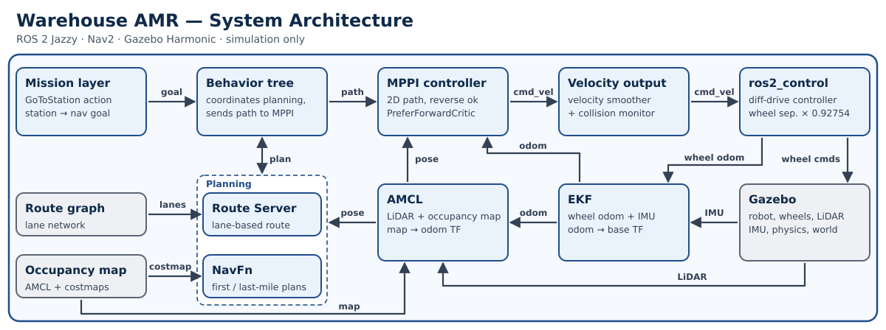

# Warehouse AMR

**Independent ROS 2 Autonomous Mobile Robot Project**

A differential-drive warehouse robot developed **in simulation** with ROS 2 Jazzy, Nav2 1.3.12 and Gazebo. It combines calibrated wheel
kinematics, structured routing with the Nav2 Route Server, MPPI control with soft-preferred forward motion, and a station-based mission layer.
The repository also keeps the measurements and reports behind each design decision.

> **Status: simulation only, work in progress.** Nothing has run on hardware. Results come from single runs and do not establish
> statistical reliability or safety. The wheel calibration is a simulator calibration. Nav2's Collision Monitor is not a substitute
> for independent physical safety measures. See [`docs/LIMITATIONS_AND_FUTURE_WORK.md`](docs/LIMITATIONS_AND_FUTURE_WORK.md).

## Demo
**[Watch the 44 s simulation demo](docs/media/warehouse_amr_demo.mp4)**: routed Station B → A, a rear-obstacle back-out, and a routed goal with a requested
+90° orientation. Simulation only; one fresh run per scenario; time-lapsed (3×, 2×, 3×, labelled on screen). How it was recorded, the numbers it shows and
its attribution: [`docs/media/README.md`](docs/media/README.md).
The video shows one selected recording per scenario. Other attempts were made while the recording setup (camera tracking) was being debugged; they
were recording-rig problems, not robot failures, and are not shown.

## Architecture


Goal (via the mission layer or directly as `NavigateToPose`) → route behavior tree: **Route Server** lane path, **NavFn** first/last mile
(keeps the requested goal yaw) → **MPPI** (2D-path interpretation, reverse allowed, `PreferForwardCritic`) → velocity smoother → collision
monitor → `ros2_control` differential-drive controller → Gazebo. Localization: EKF (wheel odometry + IMU) and AMCL on a saved map.
Details: [`docs/ARCHITECTURE.md`](docs/ARCHITECTURE.md). The diagram is generated by [`docs/figures/make_architecture_svg.py`](docs/figures/make_architecture_svg.py).

| Package (`src/`) | Role |
|---|---|
| `amr_description`, `amr_control` | robot model; `ros2_control` diff-drive (`wheel_separation_multiplier 0.92754`, simulator calibration) |
| `amr_simulation`, `amr_localization` | Gazebo world and bridge; EKF |
| `amr_navigation` | Nav2 parameters and profiles, map, route graph, route behavior tree |
| `amr_missions`, `amr_interfaces` | `GoToStation` / `ExecuteMission` actions and executors |
| `amr_perception` | AprilTag configuration and dock pose publisher |
| `amr_bringup` | one launch file composing the above |

## Accepted navigation configuration
NavFn + MPPI 2D-path interpretation (`use_path_orientations false`, `PathAngleCritic.mode 0`, `enforce_path_inversion false`) + `vx_min -0.35`
+ `PreferForwardCritic` (weight 5.0, power 1, threshold 0.5) + Nav2 Route Server with a route behavior tree that always plans the last mile,
so the requested goal yaw is honored. Goal checker: `StoppedGoalChecker` (0.25 m, 0.20 rad). Full table:
[`docs/NAVIGATION_BASELINE.md`](docs/NAVIGATION_BASELINE.md).

## Build and run (simulation)
Developed on Ubuntu 24.04 with ROS 2 Jazzy and Gazebo Harmonic (`gz sim`). Requires Nav2, `ros_gz`, `ros2_control`, `robot_localization` and
`apriltag_ros`. The world downloads models from Gazebo Fuel on first run. A fresh-clone build has not been repeated for this release.

The repository root is the colcon workspace: the packages are in `src/` and `colcon build` is run from the root, which creates `build/`, `install/` and `log/` there.
```bash
git clone <repository-url> warehouse_amr
cd warehouse_amr                      # all commands below run from here
source /opt/ros/jazzy/setup.bash
rosdep install --from-paths src --ignore-src -r -y
colcon build --symlink-install
source install/setup.bash             # needed in every new terminal, from the repository root

# Accepted baseline
ros2 launch amr_bringup simulation_navigation.launch.py \
  planner:=navfn mppi_path_interpretation:=2d_prefer_forward structured_routing:=true
```
The plain launch (no arguments) still starts the earlier Smac State Lattice + MPPI stack. Wait until `lifecycle_manager_navigation` logs "Managed nodes are
active" before sending goals (a goal sent earlier is rejected). Startup occasionally hangs (about 2 of 9 launches observed): relaunch if so. Make sure no orphaned `gz sim` or ROS
nodes from an earlier run are still running (duplicate node names cause confusing behavior).

In a second terminal (source the workspace as above), send a goal. Stations are `home`, `station_a`, `station_b` (`amr_missions/config/stations.yaml`):
```bash
# Station goal through the mission layer (uses the route behavior tree when structured_routing:=true)
ros2 action send_goal /mission/go_to_station amr_interfaces/action/GoToStation "{station_name: station_b}"

# Arbitrary pose with the route behavior tree (map frame, yaw 90 deg)
ros2 action send_goal /navigate_to_pose nav2_msgs/action/NavigateToPose "{pose: {header: {frame_id: map},
  pose: {position: {x: 8.716, y: 2.705}, orientation: {z: 0.7071, w: 0.7071}}},
  behavior_tree: '$(ros2 pkg prefix amr_navigation)/share/amr_navigation/behavior_trees/navigate_on_warehouse_route.xml'}"
```
`station_a` is a docking station and goes through `DockRobot`, which is not re-validated on this baseline (see Limitations).
**Command check (2026-11-05, one attempt each, simulation, baseline launch above).** Both commands were run verbatim with `ros2 action send_goal`:
the `GoToStation` command to `station_b` finished `SUCCEEDED` ("Arrived at station: station_b"), and the `navigate_to_pose` command with the route behavior tree
was accepted and finished `SUCCEEDED` (the robot was already at Station B from the first command, so this exercised the syntax and a rotation to +90°
(AMCL estimate about 87°, not ground-truth checked), not a routed trip). A first `GoToStation` attempt was rejected ("Nav2 rejected navigation goal") because it was
sent before Nav2 had finished activating; a leftover `mission_manager` from an earlier run was also still running and was stopped before the retry.
The `station_a` / docking path was not run.

## Engineering investigations
1. [**Yaw-rate mismatch and wheel-separation calibration**](docs/case_studies/01_yaw_rate_calibration.md): the simulator turned 7.8 % faster than commanded; one parameter (0.92754) removed it.
2. [**Planner/MPPI evaluation and reverse policy**](docs/case_studies/02_planner_mppi_reverse_policy.md): why NavFn needs the 2D-path MPPI settings, and how a soft forward preference cut reverse travel from 18 m to 0.24 m on the test route.
3. [**Route Server goal-orientation failure**](docs/case_studies/03_route_server_goal_orientation.md): the wrong-yaw "success" came from the last-mile logic of this project's custom route behavior tree (it skipped planning when the goal sat on the route end), not from a general Nav2 defect; a one-block fix in that tree restored the requested orientation.

## Selected validation results (2026-10-29, simulation, one run per test)
| Test | Result |
|---|---|
| Routed B→A staging | succeeded in 48.4 s, 0.14 m max route deviation, 0.24 m reverse |
| Free B→Home | succeeded in 48.2 s, 0.71 m reverse |
| Rear-obstacle back-out | succeeded; 0.05 m closest footprint margin at the goal (a poor margin) |
| Routed goal with +90° yaw | succeeded, −3.5° yaw error |

Scope: n = 1 per test, Gazebo ground truth, no hardware, no repeatability, no obstacles below the LiDAR plane. The rear-obstacle result is not
evidence of reliable or hardware-safe obstacle avoidance. Details: [`docs/CONSOLIDATED_VALIDATION.md`](docs/CONSOLIDATED_VALIDATION.md).

**Demo recording (separate, 2026-11-03 to 11-05):** the video was made from one fresh run per scenario. These are new observations, not repeats of the table
above: routed B→A 48.1 s with 0.27 m reverse; rear obstacle succeeded with about 0.08 m closest footprint-to-box distance (analytic, a different method from the
validation's 0.05 m raster figure; a few centimetres is not evidence of reliable or hardware-safe avoidance); routed +90° goal ended −1.3° off.
The footage is time-lapsed and labelled.

## Limitations
Simulation only; single-run evidence; simulator-specific calibration; provisional 6-node route graph; docking and AprilTag detection exist in source
but are **not re-validated** on this baseline (the AprilTag launch is separate); `ExecuteMission` was last reported working in an older report and has
not been re-run; Nav2 startup can hang. Full list and planned work: [`docs/LIMITATIONS_AND_FUTURE_WORK.md`](docs/LIMITATIONS_AND_FUTURE_WORK.md).

**Experimental, not in the baseline:** a Rotation Shim controller evaluation lives on the separate, unfinished branch
`feature/rotation-shim-integration`, built on the earlier State Lattice configuration. It is not part of the accepted baseline or its validation.

## Documentation
[`docs/README.md`](docs/README.md) indexes the architecture, baseline, validation, case studies, historical investigation reports ([`Findings/`](Findings/README.md))
and limitations. Raw rosbags are not in Git ([`docs/DATA_MANIFEST.md`](docs/DATA_MANIFEST.md)).

## Development approach
Developed with AI assistance (Claude Code); commits carry co-author trailers. [`CLAUDE.md`](CLAUDE.md) records how design ownership and
implementation work were divided.

## Licenses and third-party material
* The simulated warehouse is adapted from the Clearpath Robotics [`clearpath_simulator`](https://github.com/clearpathrobotics/clearpath_simulator)
  warehouse world (BSD-3-Clause, Copyright (c) 2023 clearpathrobotics); notice in
  [`src/amr_simulation/worlds/NOTICE-clearpath.md`](src/amr_simulation/worlds/NOTICE-clearpath.md). This project is independent and is not
  affiliated with or endorsed by Clearpath Robotics.
* The building, shelves and props are **Gazebo Fuel models by other authors under their own Creative Commons licences** (some NonCommercial and
  NoDerivatives). They are downloaded at run time, not stored here, and are not covered by the BSD notice. Licence table and authors:
  [`THIRD_PARTY_NOTICES.md`](THIRD_PARTY_NOTICES.md). Images and video of the simulation show these models.
* Other third-party material and open items: [`THIRD_PARTY_NOTICES.md`](THIRD_PARTY_NOTICES.md), [`THIRD_PARTY_REVIEW.md`](THIRD_PARTY_REVIEW.md).
* Package licences are declared per package (Apache-2.0 in most). No root licence has been chosen yet.
