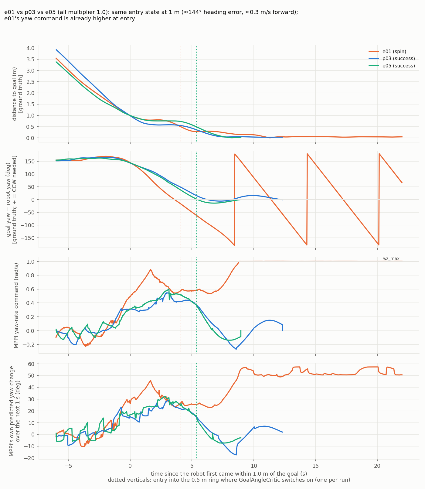
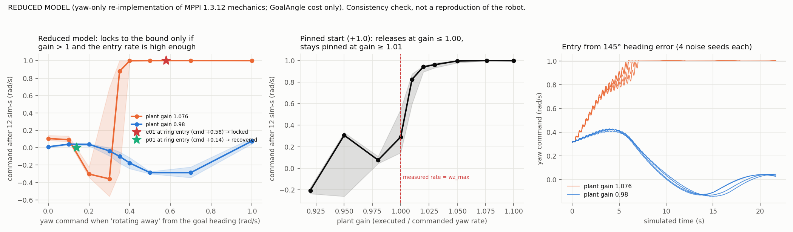

# Addendum: e01 (spin) vs p03 / e05 (successes), and the MPPI 1.3.12 source check

Date 2026-10-24 · extends `Technical_Report_BtoA_Variability_Root_Cause_Investigation.md` · **closing assessment for now**
Constraints kept: no simulation or Gazebo launched; no new data; nothing under `src/` or any Nav2 parameter changed; nothing committed; existing recordings and reports untouched. Everything below comes from existing recordings (`runs/`, `analysis/`), the upstream MPPI source for the installed version, and two short offline scripts (`scripts/addendum_*.py`).

---

## 1. Answers first

1. **What we learned that we did not know before**
   * The **mechanism that can pin MPPI's yaw command is visible in the source**: rollout yaw rates start from the *measured* rate and can only decelerate at `az_max`, while `wz_max` is enforced only by clipping the optimized sequence afterwards. When the measured rate exceeds `wz_max` (true in the uncalibrated simulator, 1.079 rad/s), the optimizer cannot release the pinned state. In a yaw-only replica of the source mechanics this is a sharp threshold at plant gain ≈ 1.0.
   * **e01 is the only run of 10 that entered the 0.5 m ring while rotating *away* from the goal heading at a high rate** (command +0.58 rad/s, heading error −18°). Its twin p01 had the same heading error (−18°) and recovered with a command of +0.14 rad/s.
   * The earliest divergence from the successes appears **at the 1 m ring, long before saturation**, and the recorded inputs (state, plan structure) do not distinguish the runs.
   * Corrections to my own report (§6): MPPI is **deterministic given its inputs** (fixed noise per goal, fixed seed), and the plan handed to MPPI is **truncated at the first inversion** (not "passing through cusps": that was an artefact of my cusp detector).
2. **Strongest explanation and confidence.** *A heading overshoot outside the goal-angle radius, entering the 0.5 m ring at a high yaw rate in the wrong direction, followed by lock-in of the pinned yaw command because the uncalibrated plant makes the measured yaw rate exceed `wz_max`.* **Confidence: moderate.** I am fairly confident (roughly two chances in three) in the *sustaining* part (the pinned state needs measured rate > `wz_max`), because it rests on source mechanics, a consistent replica and the data. I am much less confident (below even odds) about *why e01 started rotating faster at the 1 m ring*, which no recorded input explains.
3. **A concrete reason to fix something now?** **No.** The lock-in condition (measured rate above `wz_max`) cannot occur with the calibrated simulator (gain 0.98) and would on hardware only if the plant or odometry over-reports yaw rate relative to the command. No calibrated run showed it. The open calibrated *stall* is a separate, unexplained, uninstrumented observation.
4. **Can we return to mission execution and navigation supervision?** **Yes**, with two stated caveats (§8): keep the calibrated multiplier for simulation work, and treat "measured yaw rate above `wz_max`" as a condition to avoid or monitor on hardware.

---

## 2. What the MPPI 1.3.12 source establishes

Source: upstream tag `1.3.12` (commit `6be3614`), the version installed (`ros-jazzy-nav2-mppi-controller 1.3.12-1noble`); the files used are archived in `analysis/addendum/mppi_1.3.12_source_used/` (read only, nothing built or run). The following are facts about the code:

| # | Established by the source | File |
|---|---|---|
| S1 | `GoalAngleCritic` scores only when the robot is within `threshold_to_consider` (0.5 m in our config) of the **true goal position**. Cost = `3.0 × mean over the whole horizon of |shortest angle(trajectory yaw, goal_yaw)|`, where `goal_yaw` is the yaw of the **last pose of the plan handed to MPPI**, not of the final goal pose. | `goal_angle_critic.cpp` |
| S2 | In the terminal region the active critics are few: `PathAngleCritic` and `PathAlignCritic` are **off within 0.5 m**, `PathFollowCritic` off within 0.10 m (our threshold) and off for plans shorter than 2 poses; `GoalCritic` (mean distance to the goal position) is on within 1.4 m; `CostCritic` is on. | `path_angle_critic.cpp`, `path_align_critic.cpp`, `path_follow_critic.cpp`, `goal_critic.cpp` |
| S3 | `ConstraintCritic` (diff-drive) penalises **only linear velocity** outside `[vx_min, vx_max]`. There is **no angular term**. | `constraint_critic.cpp` |
| S4 | Rollouts: yaw rate at step 0 is the **measured** robot yaw rate; every later step is clamped to ±`az_max·dt` around the previous one. **There is no `wz_max` clamp in the rollouts.** `wz_max` is applied only to the *control sequence*, after the update. | `optimizer.cpp`, `motion_models.hpp` |
| S5 | Update: new sequence = softmax(−cost/`temperature` 0.3)-weighted mean of the (rate-clamped) noised controls; then clip to ±`wz_max` and accel-limit along the sequence; then a Savitzky–Golay 9-point smoothing with a 4-sample history; the command is element 1; the sequence is shifted one step (warm start). | `optimizer.cpp`, `utils.hpp` |
| S6 | `regenerate_noises: false` (our config) → the 2000×56 noise set is drawn once per reset and reused every cycle. The sampler is `xt::random::randn` on the library's default engine, a default-constructed `std::mt19937`, and MPPI never seeds it (xtensor 0.25 header checked locally). So every fresh launch uses the **same** noise set. *(Inference: that the number of draws before our goal is the same in every launch.)* | `noise_generator.cpp`, `xrandom.hpp` |
| S7 | The controller sees only the global plan **up to its first inversion** (adjacent-segment dot product `OA·AB < 0`, positions only; zero-length segments from in-place rotations never count). The rest is released only when the robot is within 0.15 m and 0.30 rad of the inversion pose (our `inversion_*` tolerances). `data.goal` is the true final goal. | `path_handler.cpp`, `utils.hpp` |
| S8 | `/optimal_trajectory` is the **integrated optimized control sequence** (no rollout clamp). | `optimizer.cpp` |

**Source versus data check (S7):** the recorded transformed-plan length equals the source model's prediction (distance to the first inversion, 2.5 m prune, or end of path) within 0.35 m in **98.5 % (e01), 97.8 % (p03), 98.1 % (e05)** of cycles. My earlier heading-based cusp rule matched only 78–84 %. The source model reproduces the recorded behaviour of the installed binary.

---

## 3. Comparison: e01, p03, e05

All three: multiplier 1.0, started at Station B, nearly identical entry into the last metre: heading error 143–145°, forward speed 0.25–0.37 m/s, distance 1.00 m. They are a fair comparison.

*Time axis: seconds since each run first came within 1 m of the goal (τ). Dotted lines: entry into the 0.5 m ring. e01 (orange) turns faster from τ≈0, passes the goal heading while still 0.64 m away, and never decelerates.*

### 3.1 Aligned values (full table: `analysis/addendum/aligned_comparison.txt`)

| τ (s) | | e01 (spin) | p03 | e05 |
|---|---|---|---|---|
| 0 | MPPI yaw command (rad/s) | **0.49** | 0.31 | 0.31 |
| 0 | MPPI's predicted yaw change over 1 s | **+26°** | +15° | +17° |
| +1 | command | **0.70** | 0.29 | 0.36 |
| +2 | command | **0.77** | 0.39 | 0.44 |
| peak before the ring | command (at τ) | **0.88 (+1.7)** | 0.55 (+3.0) | 0.60 (+3.1) |
| forward → reverse (vx crosses 0) | τ at crossing | +2.5 | +3.3 | +3.2 |
| heading error crosses 0 | τ / distance to goal | **+3.6 / 0.64 m** | +6.2 / 0.20 m | +5.4 / 0.48 m |
| enters the 0.5 m ring | τ / heading error / command | +4.1 / **−18°** / **+0.58** | +4.6 / +36° / +0.44 | +5.4 / +2° / +0.37 |
| command ≥ 0.99 rad/s | τ | **+8.8** | never (max 0.55) | never (max 0.60) |

### 3.2 Earliest meaningful difference

* **τ = 0 (entering the last metre), before the forward→reverse transition and 9 s before saturation:** the yaw command is 0.49 vs 0.31 rad/s (+58 %), MPPI's own predicted 1-s rotation is 26° vs 15–17°, and it keeps growing (0.88 at τ≈+1.7 vs ≤ 0.60).
* **The recorded inputs do not explain it.** State, speed, heading error, distance, the plan length handed to MPPI (e01 0.27 m / e05 0.28 m to the first inversion), the inversion pose yaw, and the plan-end yaw offset are all within the spread of the two successes at τ = −6 … 0 (`aligned_comparison.txt`, §4 of the earlier output). By S6 the sampler noise is identical in the three launches. So the earliest difference is in MPPI's **output** and its cause is **not recoverable from the recordings**.
* **Consequence (observed):** e01 rotated ahead of schedule, so its heading error reached zero at 0.64 m, outside the 0.5 m ring where `GoalAngleCritic` first applies (S1), and it was **still rotating at +0.58 rad/s when it entered the ring** (p03 and e05 crossed zero at 0.20 m and 0.48 m, i.e. inside or at the ring). Crossing zero outside the ring is **not** unique to e01: p01, p02 and e04 also did (0.80, 0.57, 0.91 m) and succeeded, entering the ring at +0.14, +0.24 and +0.03 rad/s. **The discriminator is the yaw rate at ring entry (§3.3), not where the crossing happened.**
* **Abnormal behaviour precedes saturation:** the divergence is visible 9 s and ≈ 0.3–0.5 rad/s before the command reaches the 1.0 limit.

### 3.3 State at entry into the 0.5 m ring, all 10 valid runs (`analysis/addendum/ring_entry_all_runs.txt`)

| run | arm | outcome | heading error | yaw command | peak command in next 15 s | rotating away? |
|---|---|---|---|---|---|---|
| **e01** | 1.0 | **spin** | −18° | **+0.58** | **1.00** | **yes** |
| p01 | 1.0 | success | −18° | +0.14 | 0.27 | no (low rate) |
| p03 | 1.0 | success | +36° | +0.44 | 0.44 | no (right direction) |
| e05 | 1.0 | success | +2° | +0.37 | 0.37 | no |
| e03 retry | 1.0 | success | −5° | −0.12 | 0.12 | no |
| p02, p04r, p06, e02, e04 | 0.92754 | success | −22…−3° | −0.29…+0.24 | 0.16–0.29 | no |

e01 is the only run entering the ring rotating **away** from the goal heading at a high rate. (p01 has the same heading error with a quarter of the rate and recovered.)

### 3.4 What MPPI follows near the goal (within 0.5 m)

The sign of the yaw command agrees with the plan-end yaw that `GoalAngleCritic` uses (S1) in **33 %** of cycles in e01, and with the true goal yaw in **44 %**; in p03 **83 % / 76 %**, in e05 **63 % / 62 %**. In the spin MPPI follows **neither** target: the "moving target chase" explanation is not supported. The plan-end yaw is the true goal yaw in only 36 % of e01's near-goal cycles (e05: 99 %, p03: 72 %), but it does not matter, because the command ignores both.

### 3.5 Does the critic prefer the spin? (computed with the S1 formula on recorded states)

At 7 sampled instants of the spin (t = 38 … 50 s), the goal-angle cost of the **recorded optimal trajectory** is 1.8–7.5; simply **braking to a stop** would cost 0.2–6.1 (**1.0–1.9 lower in every case**) and a shortest-way controller 0.2–5.2. At temperature 0.3 a 1.0–1.9 unit advantage is a factor of ~30–550 in softmax weight. So **the goal-angle critic does not favour the chosen rotation; the optimizer cannot reach the better trajectories.** Other critics: `GoalCritic` depends on position only (rotation in place does not change it); `CostCritic` skips every trajectory point whose centre cell is free space (`pose_cost < 1 → continue`, source) and the centre cell here is free (nearest non-zero cell 0.45 m away; the rotating footprint does overlap inflated cells, values 55–74 of 100, but those are never evaluated for free-space centres), so it adds nothing yaw-dependent; `ConstraintCritic` has no angular term (S3). I did not replay the full cost function; this is an evaluation of the yaw-dependent terms only.

---

## 4. Assessment of the five candidate mechanisms

| Mechanism | Verdict | Evidence |
|---|---|---|
| **1. Control-sequence saturation / optimizer lock-in** | **Supported (strongest)** | S4+S5: the rollout rate is clamped around the measured rate and only the sequence is clipped; with the measured rate above `wz_max` the pinned state cannot release. Data: the command is pinned at exactly 1.00 for ≥ 14 sim-s; MPPI's own predicted path rotates at +51…+57°/s through the goal heading; braking would be cheaper (§3.5). Reduced model (§5) shows a sharp threshold at plant gain 1.0. **Not demonstrated on the full controller.** |
| **2. A critic that favours continued rotation** | **Not supported** | §3.5: the goal-angle critic prefers stopping by a large margin at all sampled instants; `ConstraintCritic` has no angular term (S3). The terminal critic set is small (S2). |
| **3. Rapid change of near-goal global-plan geometry** | **Associated, not shown causal; target-chase not supported** | Plans in the spin are short, looped, cusp-flipping, sometimes 1 pose (earlier report §5.4), but MPPI follows neither the plan-end yaw nor the goal yaw (§3.4). The plan is regenerated from the rotating robot, so the geometry is plausibly a consequence. |
| **4. Forward/reverse transition interacting with the optimizer** | **Contributing context** | All three runs make the same forward→reverse transition (the plan's first inversion is 0.2–0.9 m ahead). The transition itself does not distinguish them (τ+2.5 … +3.3), but e01 was already rotating faster through the last forward metre and the reverse leg and entered the goal-angle ring still rotating (§3.2–3.3). The source shows the controller sees the plan only up to that inversion (S7), so near the cusp the active target pose is the inversion pose. |
| **5. Yaw-rate discrepancy (plant gain)** | **Supported as a necessary sustaining condition, not as a trigger** | Measured (fused odometry) rate 1.079 > `wz_max` 1.0 in the spin; with gain 0.98 impossible. But 4 of 5 uncalibrated runs, same gain, succeeded: they never pushed the command above ≈ 0.69, i.e. the measured rate stayed below 1.0 (0.69 × 1.076 = 0.74). |

---

## 5. Reduced-model consistency check (`scripts/addendum_yaw_replica.py`)

**Label: a yaw-only re-implementation of the S4–S6 mechanics (GoalAngle cost only; robot assumed at the goal position; plant = gain × command delayed 0.3 s). It is a consistency check of what the source allows, not a reproduction of the robot and not proof.** Results (20 noise seeds, `analysis/addendum/replica_sweeps.txt`, figure below):

* **Pinned start (command +1.0, goal needs a CW turn):** releases at plant gain ≤ 1.00, stays pinned at ≥ 1.01 (all seeds), a sharp threshold at "measured rate = `wz_max`".
* **"Rotating away" entry:** with gain 1.076, a start command ≤ 0.30 recovers (reverses to CW); ≥ 0.40 locks to the bound in 8/8 seeds. With gain 0.98 nothing locks even at 0.5. The real pair at ring entry (p01 +0.14 recovered, e01 +0.58 locked) falls on the right sides of that threshold. (A prediction, not a fit: the threshold was not tuned to those values.)
* **Where the model is wrong:** entering from 145° with only a goal-angle cost, the replica pins at gain 1.076 in **20/20** seeds, whereas 4 of 5 real uncalibrated runs succeeded. The model over-predicts failure because it lacks the path critics and the real approach geometry. So the replica supports the **sustaining** condition, not the **trigger**.

---

## 6. Corrections to the main report

1. §6 H1 / §1 "plans contain cusps in 12–21 % of messages": an artefact of my heading-based cusp detector. MPPI truncates at the first position-based inversion (S7, 98 % agreement). Cusps are **not** passed through; the statement "cusps inside the transformed plan occur in every run" should read "heading-defined cusps occur…, which MPPI does not treat as inversions".
2. "MPPI is stochastic": the noise set is fixed per goal and, by S6, identical across launches. Run-to-run differences come from differing **inputs** (sim timing, AMCL/EKF noise, plan update phase), amplified by a deterministic optimizer.
3. §6 H1 candidate mechanism (b) "goal-angle cost over a horizon sweeping through the goal heading": superseded by §3.5 (the critic prefers stopping).
4. §2.3 "no source available locally": the upstream source for 1.3.12 was obtained for this addendum.

---

## 7. Remaining uncertainties

* **Why e01's yaw command was higher at τ = 0 … +2** (inputs are not distinguishable; needs per-cycle control sequences or critic costs).
* **Whether the reduced-model threshold holds in the full controller** (it needs the path critics and the real plan; testable only by new runs).
* **Why the calibrated arm took the "reverse into goal" route more often** (route-family difference, earlier report §H2).
* **Whether the Oct 23 calibrated stall shares anything with this**: the replica gives no stall; it remains unexplained.
* **Sample:** one failure; all statements about thresholds and rates are from a single spin and a reduced model.
* **Hardware:** the lock-in condition depends on the plant gain of this simulator (contact-model effect); it should be re-checked on hardware.

---

## 8. Recommendation

* **No corrective work needed now; the issue can stay open while AMR development continues.** Reasons: the sustaining condition (measured yaw rate above `wz_max`) does not occur with the calibrated simulator; the failure appeared in 1 of 10 runs and only in the uncalibrated arm; nothing indicates a defect in the mission layer or in the calibrated baseline.
* **Two cheap guardrails, for your decision (not implemented):**
  1. Keep `wheel_separation_multiplier: 0.92754` for simulation work and do not mix uncalibrated runs into evidence.
  2. On hardware, verify that the yaw rate measured by the odometry/EKF does not exceed the commanded rate (plant gain ≤ 1) before trusting `wz_max = 1.0`; if it can, a supervisory check "measured |wz| > `wz_max` for > N s while within 0.5 m of the goal → cancel and report" would turn an indefinite spin into a bounded, recoverable failure. This is a supervision decision, not a tuning change.
* **Reopen if:** a calibrated run shows a pinned yaw command, a spin appears on hardware, or the stall from Oct 23 recurs under instrumentation.
* **If the investigation is ever resumed, the single most informative experiment** is the targeted harness of the main report (§9.1) with the new prediction: *at ring entry, a yaw command ≥ ≈ 0.4 rad/s rotating away from the goal heading locks in the uncalibrated arm and does not in the calibrated arm.* It would also need MPPI's cost information (main report §8.2) to move from "consistent" to "demonstrated".

---

## 9. Files

| Path | Content |
|---|---|
| `scripts/addendum_compare.py` | aligned comparison, target-yaw offsets, counterfactual goal-angle costs |
| `scripts/addendum_yaw_replica.py` | reduced yaw-only replica (clearly labelled) |
| `scripts/addendum_figures.py` | the two figures |
| `analysis/addendum/aligned_comparison.txt`, `ring_entry_all_runs.txt`, `replica_sweeps.txt`, `series.pkl` | numbers quoted here |
| `analysis/addendum/fig_addendum_aligned.png`, `fig_addendum_replica.png` | figures |
| `analysis/addendum/mppi_1.3.12_source_used/` | the upstream 1.3.12 source files read (reference only) |
| earlier figures reused: `analysis/e01_m1.0/fig_timeline.png`, `fig_snapshots.png`, `analysis/cmp_distance_rotation.png` | not regenerated |
