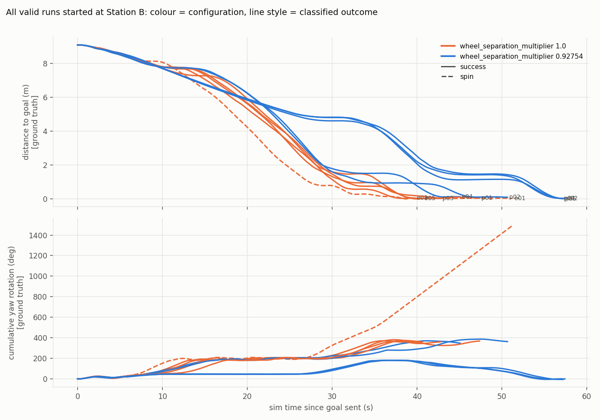
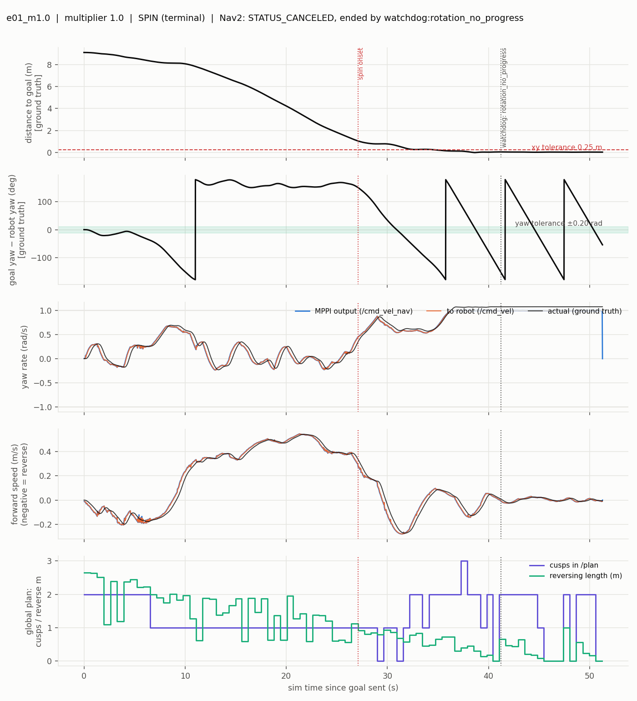
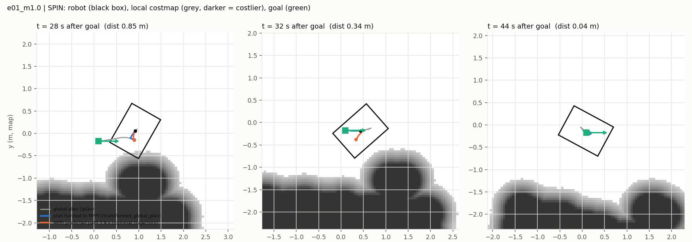

# B → A navigation variability: root-cause investigation (instrumented runs, 2026-10-23)

**Branch** `feature/bidirectional-navigation-baseline` (HEAD `c57e6bd`, working tree dirty, nothing committed) · **Scope** diagnosis only. No Nav2/MPPI/planner/controller parameter and nothing under `src/` was changed. Experiment scripts live in `investigations/btoa_variability_2026-10-23/`.
Predecessors: `calibration/nav_validation/reports/b_to_a_validation_report.md` (Oct 22), `Findings/Warehouse_AMR_BtoA_Behaviour_Variability_2026-10-23/` (uninstrumented Oct 23 runs).

---

## 1. Bottom line

* **Sample:** 10 valid instrumented runs, all started with the robot spawned at Station B (5 with `wheel_separation_multiplier` 1.0, 5 with 0.92754). 4 further launches failed at startup for infrastructure reasons and are excluded. The sample was cut short by the operator's time limit (planned 4 extension pairs, 2.5 run in).
* **Outcomes:** 1.0 arm: **4 success, 1 spin**. 0.92754 arm: **5 success**. No stall was captured. The Oct 23 *stall* (calibrated, uninstrumented) was **not reproduced** and remains unexplained.
* **One well-recorded failure:** run `e01` (multiplier 1.0), a terminal spin: the robot reached the goal position, then rotated in place at 1.07 rad/s (three further passes through the goal heading) with MPPI's yaw command pinned at ≈1.0 rad/s until the run was cut.
* **What the evidence supports** (details §5–§7):
  1. The failure is located **inside MPPI's near-goal behaviour**, not in the plant, localization or controller timing: its own predicted trajectory keeps rotating through the goal heading and never decelerates, while the plan it receives reaches the goal.
  2. The spin happened in a **specific manoeuvre**: arriving at the goal *forward with a large heading error (≈120–145°)* and then having to rotate in the last metre. 5 of 10 valid runs entered that manoeuvre (4 of the 5 uncalibrated runs, 1 of the 5 calibrated runs); 1 of those 5 spun. The 5 runs that arrived reversing into the goal (peak yaw demand ≤0.39 rad/s) all succeeded.
  3. The calibration matters through **margin**: every uncalibrated run, successes included, demanded more yaw (peak 0.55–0.69 rad/s) than every calibrated run (0.37–0.46), and the spin is the only run that reached the 1.0 limit. In the spin the executed rate (1.076×command) and the fused-odometry feedback (1.079 rad/s) exceed MPPI's own `wz_max`.
* **What it does not support:** a failure *rate* for either arm; causation; any claim about timing/load (no effect seen) or localization (no effect seen) beyond this sample.
* **Which hypothesis to test next** (§9): *"the large-rotation-at-the-goal manoeuvre, executed at or above MPPI's yaw limit, makes MPPI's optimizer lock into continuous rotation."* It is testable cheaply with a targeted harness (§9.1) and it needs the one measurement this build cannot give: MPPI's per-critic costs.

---

## 2. Experimental design

### 2.1 What was held fixed

* **Start:** robot spawned at Station B `(8.716, 2.705, yaw 0)`, AMCL initial pose set there; Home → B → A runs were *not* mixed in. Goal: B→A staging pose `(0.099, −0.175, 0)`.
* **Single difference between arms:** the `wheel_separation_multiplier` line in the controllers file. Both arms are generated by the same script from the current repo files (`scripts/make_variants.py`); `runs/<id>/variant/variant.json` records the diff against `src/…/controllers.yaml` (one line for 1.0, none for 0.92754), and `runs/<id>/loaded_multiplier.txt` / `param_dump/` record what the controller actually loaded. The configs: `nav2_params.yaml` sha256 prefix `8e4ac952a526104e`, `controllers.yaml` `2cdb5b0f9ef5f713` (calibrated value). Notable settings in force: `StoppedGoalChecker` xy 0.25 m / yaw 0.20 rad; MPPI `wz_max 1.0`, `vx_min −0.35`, `visualize: true`, `enforce_path_inversion: true`, `prune_distance 2.5`; State Lattice with reverse expansion enabled; `controller_frequency 20 Hz`.
* **Limits:** 120 sim-s after goal acceptance **and** a 330 s wall-clock safety limit; an online watchdog (existing `nav_watchdog.py`) may end a run 10 sim-s after it first detects a spin/stall, after which the goal is cancelled. This is recorded as `end_reason` per run. (e01 ended this way.)
* **Order:** arms interleaved (1.0, 0.92754, …) to spread slow drift in machine load over both arms.

### 2.2 What was recorded (per run)

Rosbag (mcap, wall-clock log time; header stamps are sim time): `/tf`, `/plan`, `/unsmoothed_plan`, `/transformed_global_plan`, `/optimal_trajectory`, the complete command chain (`/cmd_vel_nav` → `/cmd_vel_smoothed` → `/cmd_vel` → `/diff_drive_controller/cmd_vel_out`), raw and fused odometry, IMU, joint states, `/amcl_pose`, `/scan`, `/local_costmap/costmap`, footprint, collision-monitor state, BT log, `/diagnostics`, `/rosout`, and NavigateToPose / FollowPath / ComputePath action status and feedback. Plus: Gazebo ground truth (`gt.csv`, flushed incrementally), 1 Hz system monitor (`sysmon.csv`: real-time factor, load average, per-process CPU), client trace/events/result, full parameter dump of all nodes, provenance, load snapshots at start/end, launch log.

### 2.3 Not recorded: missing measurements

| Missing | Why | Consequence |
|---|---|---|
| MPPI **per-critic costs** / sampled-trajectory costs | not published by this build (`nav2_mppi_controller` 1.3.12); `/trajectories` (≈1.9 MB/message) is published but carries no costs and was left out for size | the *reason* MPPI keeps rotating cannot be read from the data |
| MPPI internal state (control sequence, which critics are active) | not exposed | same |
| Nav2/Smac internals (why a 1-pose plan, why cusps flip) | not exposed | §5.4 stays descriptive |
| Source of the installed MPPI/controller (only binaries installed) | no source available locally | statements about code behaviour are marked unverified |

### 2.4 Deviations from the protocol (all logged in `CHANGES.md`)

* Infrastructure failures excluded: `p04_m0.92754` and `p05_m1.0` (Nav2 aborted bringup: global costmap could not get `base_footprint→map`), `p05_m1.0_retry1` (Gazebo never served `/world/warehouse_world/create` within 150 s), `e03_m1.0` (AMCL's `change_state` response was dropped by the middleware, AMCL never activated, no `map` frame). The first and last share a signature: `failed to send response … (timeout)`. 4 of 14 launches (29%) failed this way, all before any goal; it is a startup problem, not a navigation one.
* Driver changed during the pilot: v1 sequential parameter dump (p01–p04) → v2 parallel dump (from p05) → v3 early abort on a lost lifecycle response. Parameter-dump step only; nothing that affects the goal or recorders. `runs/<id>/driver_version.txt` states which driver ran each run.
* **Machine load changed mid-experiment**: the operator closed the browser and other apps after p05. Load average ranged 10–32 on 16 cores across runs; it is logged per run and no relation to outcome was seen (§6).
* e05: one `ros2 param dump` call hung 4 minutes (dropped service responses); I killed it so the run could proceed. e05 is valid (goal sent normally, `SUCCEEDED`); one node's parameter file is empty.
* The extension was stopped after e05 **on a time limit**, not on outcomes. Smoke runs `smoke01`, `smoke02` (25 sim-s limit) are kept and not counted.

---

## 3. Outcome classification

Criteria were written before the pilot was analysed (`config/classification_criteria.yaml`) and applied to **ground truth** and Nav2's own result, never to the online watchdog. `SUCCESS`: Nav2 `SUCCEEDED` (flag if ground truth violates the 0.25 m / 0.20 rad tolerance — none did). `SPIN`: |mean GT yaw rate| ≥ 0.8 rad/s over a 15 s window while speed ≤ 0.25 m/s (subtype terminal if within 0.5 m of the goal). `STALL`: net displacement ≤ 0.25 m and |yaw rate| ≤ 0.15 rad/s over 20 s while the goal is unmet. `OTHER_FAILURE`, `INCONCLUSIVE` otherwise (infrastructure failures are INCONCLUSIVE).

### 3.1 Summary table (valid runs; full table: `analysis/summary_table.csv`, `.md`)

| run | arm | outcome | sim s | t < 1 m (s) | final err (m / °) | peak MPPI \|wz\| (rad/s) | exec/cmd yaw gain | RTF | load₁ |
|---|---|---|---|---|---|---|---|---|---|
| **e01** | 1.0 | **SPIN (terminal)** | 51.3 (cut) | 27.3 | 0.047 / still rotating | **1.00** | 1.07 | 0.62 | 20.3 |
| p01 | 1.0 | success | 47.4 | 32.0 | 0.056 / 8.5 | 0.69 | 1.06 | 0.58 | 20.3 |
| p03 | 1.0 | success | 42.8 | 30.4 | 0.034 / 1.0 | 0.55 | 1.05 | 0.70 | 10.0 |
| e03 (retry) | 1.0 | success | 39.7 | 35.7 | 0.061 / 2.3 | 0.59 | 1.05 | 0.61 | 26.0 |
| e05 | 1.0 | success | 40.6 | 31.7 | 0.028 / 0.2 | 0.60 | 1.04 | 0.62 | 14.4 |
| p02 | 0.92754 | success | 50.7 | 33.9 | 0.105 / 3.0 | 0.46 | 0.975 | 0.70 | 16.0 |
| p04 (retry) | 0.92754 | success | 57.1 | 52.4 | 0.049 / 0.5 | 0.40 | 0.982 | 0.60 | 15.7 |
| p06 | 0.92754 | success | 57.2 | 52.4 | 0.017 / 5.4 | 0.39 | 0.982 | 0.64 | 20.1 |
| e02 | 0.92754 | success | 57.4 | 53.1 | 0.044 / 0.3 | 0.37 | 0.981 | 0.62 | 17.9 |
| e04 | 0.92754 | success | 45.1 | 39.3 | 0.135 / 11.2 | 0.39 | 0.98 | 0.61 | 31.7 |

Counts: 1.0 arm 1 spin / 5 (exact 95% interval for the true spin probability ≈ 0.5%–72%); 0.92754 arm 0 failures / 5 (upper 95% bound ≈ 52%). **These samples cannot support a rate for either arm.**

*Ground-truth distance to the goal (top) and cumulative yaw rotation (bottom), colour = configuration, dashed = spin. e01 follows the others until ≈ 33 s, then keeps rotating (slope = 62°/s) while all successful runs settle at 350–390° total (or ≈ 0° for the reversing runs).*

---

## 4. How each run is documented

Per run: `runs/<id>/` (bag, `gt.csv`, `sysmon.csv`, logs, `classification.json`) and `analysis/<id>/` (`metrics.json`, `fig_timeline.png`, `fig_paths.png`, `fig_snapshots.png`, `fig_association.png`, `fig_timing_localization.png`). Figure meanings:

* `fig_timeline`: GT distance and yaw error to the goal; MPPI yaw-rate and speed commands vs what the robot actually did; number of cusps / reversing length in the current global plan; event markers.
* `fig_paths`: map-frame ground-truth path, first and last raw global plan, cusps, final footprint.
* `fig_snapshots`: three moments around the failure (or the end of a success): local costmap, robot footprint, the global plan, the plan handed to MPPI, and MPPI's predicted path.
* `fig_association`: transformed (local) plan length vs what it should be given the global plan, prune distance and next cusp; cross-track error; loop-ambiguity flag.
* `fig_timing_localization`: MPPI cycle intervals (wall and sim), real-time factor and load, CPU, localization error.

---

## 5. The failure case: e01 (uncalibrated terminal spin)

### 5.1 Observed sequence (ground truth + commands)

* 0–26 s: normal cruise; reversing and forward legs as planned (first plan has 2 cusps, 2.6 m of reverse).
* ≈ 27 s: robot within 1 m of the goal **moving forward with a 145° heading error**, MPPI commanding +0.49 rad/s.
* 27–37 s: yaw command grows 0.4 → 1.0 rad/s while the robot is still closing the last 0.3–1 m; the goal heading (yaw error 0) is passed for the first time at ≈ 31 s while the position error is still 0.6 m.
* From ≈ 37–38 s: robot within ≈ 10 cm of the goal, speed ≈ 0, **MPPI `wz` pinned at +1.00 rad/s**; true yaw rate 1.079 rad/s; the goal heading is crossed again at ≈ 38.7, 44.5 and 50.3 s (spacing 5.8 s = one turn at 1.08 rad/s) without any deceleration. Nav2 never reports success (the goal checker also requires the robot to be stopped).
* 41.2 s: the online watchdog (`rotation_no_progress`) fires; the run is recorded for 10 more sim-s and the goal is cancelled (51.3 s).

### 5.2 State at 1-second resolution (excerpt)

(GT pose and yaw; MPPI command; the current global plan; the plan handed to MPPI; MPPI's predicted yaw change over its next 1 s.)

| t (s) | GT yaw (°) | MPPI wz | global plan: poses / length (m) / cusps / start→end yaw (°) | transformed plan: poses / length / end→goal | MPPI predicted Δyaw in 1 s |
|---|---|---|---|---|---|
| 30 | −34 | +0.68 | 16 / 1.01 / 1 / −45→0 | 13 / 0.86 | +32° (rev) |
| 36 | −167 | +0.96 | 19 / 1.25 / 2 / 153→0 | 5 / 0.28 | +48° |
| 41 | 140 | +1.00 | **1 pose / 0.00** | 1 / 0.00 | +57° |
| 45 | **+27** | +1.00 | 4 / 0.23 / 1 / 27→0 | 1 / 0.00 | **+51° (CCW)** |
| 47 | 151 | +1.00 | **1 pose / 0.00** | 1 / 0.00 | +57° |
| 50 | −24 | +1.00 | 10 / 0.38 / 2 / −27→0 | 2 / 0.08 | +51° |

At t = 45 s the shortest way to the goal heading is 27° **clockwise**; MPPI's own predicted path rotates counter-clockwise at ≈0.9 rad/s, i.e. away from it, continuing through the goal heading. (That MPPI turns "away from the shortest direction" is **not** by itself abnormal: in the four successful runs that had enough near-goal cycles with a heading error above 10° (p01, p02, p03, e05) it does so in 32–42% of them, because it follows plan manoeuvres. What differs is the magnitude: the mean |yaw command| over all cycles within 0.3 m of the goal is **0.93 rad/s in e01 against 0.03–0.17 rad/s in each of the nine successful runs**.)

### 5.3 Plant and feedback during the spin

| signal (median, t ≥ 38 s) | rad/s |
|---|---|
| MPPI command (`/cmd_vel_nav`) | 1.001 |
| ground-truth yaw rate | 1.079 |
| IMU yaw rate | 1.079 |
| **fused `/odom` twist** (Nav2's `odom_topic`) | **1.079** |
| raw wheel odometry (`/diff_drive_controller/odom`) | 1.001 |

The executed rate is 1.076× the command (the Oct 22 plant gain, as expected for multiplier 1.0), and MPPI's own state feedback therefore shows a rate above its `wz_max`. In the calibrated arm the gain is 0.975–0.982 and this cannot occur.

### 5.4 Global-plan geometry near the goal

During the spin the raw lattice plan is regenerated every ≈1 s from the (rotating) robot pose. Plans in this phase are very short (0–1.5 m), have 0–3 cusps that change from plan to plan, accumulate large turning (up to 3.5 rad in 0.65 m; length/straight-line up to 8×), and several are **degenerate single-pose plans** (poses = 1, length 0.00; at t ≈ 41, 46, 47, 51 s). Whether these plans cause the continuous rotation or are a consequence of it (they start at the robot's current heading, which sweeps 62° per second) cannot be decided from this data.

---

## 6. Hypothesis-by-hypothesis assessment

Evidence classes: **[M]** measured in this data · **[I]** inferred from measurements · **[U]** unresolved / missing measurement.

### H1. MPPI trajectory selection or path association

* [M] **Path association/truncation is not the mechanism in e01.** The plan handed to MPPI matched the expected length in 99.9% of messages (`frac_short_transformed` 0.0014 in e01; 0–1.6% in all runs), ended at the goal in the spin snapshot (0.0 m gap), cross-track error ≤ 0.13 m, and the nearest-point index jumped by more than 0.5 m only 3 times. Loop ambiguity of the nearest path point appears in 14% of e01's messages but ≈0–0.2% in other runs — **only in the spin phase, where the plans themselves are short loops**, so it is at least as likely a consequence of the pathology as a cause.
* [M] **The selection itself is where the failure is visible:** MPPI's predicted 2.8 s path (`/optimal_trajectory`) keeps rotating through the goal heading (+51…+57° per second) and never decelerates; the command is pinned at the limit.
* [U] **Why** the optimizer prefers that: per-critic costs and the control sequence are not observable. Candidate mechanisms (not tested): (a) with the state feedback above `wz_max`, the constraint/limit handling no longer discriminates between samples and the clipped control sequence stays at the bound; (b) goal-angle cost over a horizon that sweeps through the goal heading; (c) path-angle/align critics chasing a moving, re-planned target.
* [M] Cusps inside the transformed plan occur in 12–21% of messages in **every** run (including successes), also near the goal (≈20 messages within 1 m in e01, p01, p02) — not a discriminator. Whether MPPI's `enforce_path_inversion` truncates exactly where my cusp detector says is **[U]** (source unavailable).

### H2. Global-path geometry near the goal, forward/reverse transitions

* [M] The first global plan is **identical in all 10 runs** (188 poses, 9.48 m, 2 cusps, 2.64 m reversing; maximum pointwise difference 0.0 m; `analysis/cmp_first_plans.png`). So the arms start from the same plan; differences arise during execution.
* [M] **Approach family.** The runs fall into two groups by how they enter the last metre (`analysis/terminal_entry_state.txt`):
  * *Forward with large heading error* (yaw error 120–145° at 1 m, speed +0.15…+0.37 m/s, then a rotation inside the last metre): e01 (spin), p01, p03, e05 (all 1.0) and p02 (0.92754). Peak MPPI yaw demand after entering: 0.46–1.00.
  * *Reversing into the goal* (yaw error −60…+3°, speed −0.20…−0.35 m/s): e03-retry (1.0), p04-retry, p06, e02, e04 (0.92754). Peak yaw demand: 0.12–0.39.
  
  4 of 5 uncalibrated runs and 1 of 5 calibrated runs took the first route (Fisher exact two-sided p ≈ 0.21, i.e. not distinguishable from chance with n = 5 per arm). **Why the two arms differ in route choice is [U].**
* [M] The only failure occurred in the first family (1 of 5); none of the 5 runs in the second family failed. [I] The vulnerable condition looks like "large rotation required inside the last metre"; with 1 failure this is an association, not a demonstrated cause.
* [M] In the spin the near-goal plans are the pathological short, looped, cusp-flipping plans of §5.4. [U] cause or effect.

### H3. Commanded vs executed motion

* [M] Command chain is faithful: final `/cmd_vel` equals MPPI output (median ratio 1.00, peak identical); the plant follows with a **0.25–0.35 s lag** and, per arm, a fixed gain: executed/commanded yaw 1.04–1.07 (1.0 arm) vs 0.975–0.982 (calibrated); forward speed gain ≈ 1.0 in both. Raw wheel odometry reads 0.93–0.97× truth in the uncalibrated arm and 1.00–1.02× in the calibrated arm; the fused (EKF) estimate and the IMU agree with truth.
* [M] MPPI's one-second-ahead predicted position error vs truth is small and similar in all runs (p95 ≈ 0.07–0.11 m), so the model mismatch is not large over 1 s in ordinary motion.
* [I] The mismatch **matters only at saturation**: in the spin the executed rate (1.079) is above MPPI's limit. It is not sufficient for failure: 4 of 5 uncalibrated runs, with the same gain, succeeded.
* [M] **Margin:** the uncalibrated runs demand more yaw (peak 0.55–0.69 rad/s) than the calibrated ones (0.37–0.46) even when they succeed. [U] why (not explained by the 5–8% plant gain alone); it may reflect the different route families above.

### H4. Localization errors

* [M] AMCL vs ground truth: median 0.02–0.04 m, p95 0.05–0.085 m (max 0.06–0.11 m), yaw error ≤ 2.3°, **no difference between the spin and the successes**. Nav2's feedback pose matches. The `map→odom` transform jumps by up to 0.25 m between samples (97 steps > 5 cm in e01; 39 in p01), but similarly in successes.
* [I] Localization did not drive the failure in this sample.

### H5. Timing and computational load

* [M] **No timing anomaly in e01 or any run:** MPPI outputs arrive every 0.050 s of wall time (p95 0.051 s, max 0.053–0.064 s); no "control loop missed its rate" warning in any of the 10 valid runs (one occurred in the earlier uninstrumented stall run). Real-time factor 0.58–0.70 (e01: 0.60–0.62, steady). Load average 10–32 on 16 cores with no relation to outcome (e01 was in the middle of the range).
* [M] **Observed characteristic (all runs):** the controller loop is paced by wall-clock time (20 Hz wall) while the simulation runs at ≈0.6× real time, so in *sim* time MPPI cycles every 0.030–0.036 s (≈ 30 Hz) rather than 0.05 s; the plant therefore advances only ≈ 0.03 s between MPPI updates, and the 0.3 s plant lag spans ≈ 10 control cycles instead of 6. This is constant across arms and outcomes, so it **cannot explain the variability**, but it is a property of this simulation setup that real hardware will not share (see §9.4).
* [I] Heavy load did affect **startup** (4 of 14 launches failed before any goal, with dropped service responses). Whether it affects navigation outcome needs the instrumented repeats; it did not here.

---

## 7. What the evidence does and does not establish

| Statement | Status |
|---|---|
| The uncalibrated spin is real, reproducible in kind, and non-deterministic (1 of 5 here; also 2 of 4 earlier uninstrumented) | observed |
| During the spin MPPI's own plan rotates through the goal heading and is pinned at its yaw limit while feedback exceeds that limit | observed |
| The failure is in MPPI's near-goal selection, not in path truncation, localization, or loop timing | supported for e01 only |
| The spin requires the plant gain of the uncalibrated model | **not established**: 4 of 5 uncalibrated runs succeeded, and only one calibrated run (p02, which succeeded) entered the vulnerable manoeuvre, so the arms cannot be compared on it |
| The calibration removes the failure | **not established**: 0 of 5 calibrated failures here, but only one calibrated run took the vulnerable route, and an uninstrumented calibrated run stalled earlier today |
| The Oct 23 calibrated *stall* is explained | **no** (not reproduced) |
| Any failure rate | **no** (n = 5 per arm) |

---

## 8. Recommended experiments (ordered; none run)

1. **Targeted-manoeuvre harness** (§9.1): reproduce the vulnerable condition directly (robot a short distance before the goal with a large heading error) many times per launch, both arms, with the existing instrumentation. This gives ten times more failure opportunities per hour than full B→A routes and removes the route-choice confounder.
2. **Record MPPI cost information** for a bounded window (e.g. `/trajectories` for the last 15 s only, or a build of MPPI with critic-statistics publishing if a newer minor release has it). This is the one measurement that can say *why* the optimizer rotates; it needs the owner's decision because it changes the MPPI build or its visualization settings.
3. **Stall hunt:** run the calibrated arm with the existing instrumentation until a stall like the Oct 23 B2 run is captured. That run ended with the goal about 106° off the robot's heading (behind it), 0.54 m away; its approach family is unknown, so I do not claim it relates to the vulnerable manoeuvre above. The targeted harness can include start poses that reproduce that end geometry.
4. **Load decoupling:** a headless (no Gazebo GUI, no RViz) variant to separate load effects from route effects, and an RTF ≈ 1 variant to test the sim-time compression noted in H5.
5. **Source check** of MPPI 1.3.12 (goal-angle critic, path-inversion handling, constraint critic) to turn the candidate mechanisms in H1 into testable predictions.

## 9. Details for the recommended next hypothesis

### 9.1 Targeted harness sketch (for the owner to approve)
Keep one simulation running; between trials teleport the robot (gz `set_pose` service) to a start 1–2 m from the goal with a heading error drawn from {±60°, ±120°, ±150°, 180°}, reset the AMCL pose, send the goal, classify with the existing criteria, repeat 20–30 times per arm. Nothing in `src/` changes; the start poses are the experimental factor.

### 9.2 Predictions that would confirm or refute it
* If the lock-in needs MPPI's limit to be exceeded by the plant, the **uncalibrated arm spins at ≥120° heading errors and the calibrated arm does not (or much less)**.
* If it is a property of the cost landscape/sampling regardless of the plant gain, **both arms spin** at similar rates in that manoeuvre.
* If route/path geometry is the driver, the failure rate should depend on the start position more than on the arm.

### 9.3 Not recommended before (1) and (2)
Tuning critic weights, goal tolerances, `wz_max`, or MPPI sampling settings: any improvement would be uninterpretable without knowing the mechanism, and this sample cannot detect a rate change.

### 9.4 Simulation-specific caveat
The multiplier and the sim-time compression (H5) are properties of this simulator (contact model, RTF 0.6); both must be re-identified or re-checked on hardware.

---

## 10. Limitations

* 5 vs 5 valid runs, 1 failure, 4 infrastructure failures excluded; the stopping point was time-driven.
* The two arms differ in route family (§H2), so the arm effect and the route effect are confounded in this sample.
* Machine load, and RViz/Gazebo GUI load, were present and not controlled; the browser was closed mid-experiment.
* No MPPI internals; no critic costs; MPPI/Nav2 source not available locally.
* Ground truth is Gazebo's model pose; AMCL error was analysed only against it.
* The earlier uninstrumented runs (Oct 22–23) are context, not part of this sample; they used partially different initial conditions (Home start, no ground-truth recorder before 10:49).

---

## 11. Reproduction

`investigations/btoa_variability_2026-10-23/README.md` has the layout and commands. In short: `scripts/run_experiment.sh <id> <multiplier>` per run (refuses to overwrite; checks `/home` space; sim-time and wall-clock limits; always finalizes the bag and shuts the sim down), then `classify.py`, `extract.py`, `analyze_run.py` per run and `compare_runs.py` for the table and comparison figures. Config: `config/`. Change log of every deviation: `CHANGES.md`. Raw data: `runs/`.

---

## 12. Handoff (project standard)

**Changed / proposed:** created `investigations/btoa_variability_2026-10-23/` (scripts, config, per-run data, analysis, this report). No source, parameter or git changes; nothing committed. Proposals only in §8–9.

**Verified:** 14 instrumented launches (10 valid runs, 4 infrastructure failures) + 2 smoke runs; every valid run classified by the documented criteria and analysed; figures regenerated by `compare_runs.py` / `analyze_run.py`. **Not run:** any extra repeats beyond e05, the targeted harness, any run with MPPI internals, any hardware.

**Open issues:** cause of the continuous rotation inside MPPI; cause of the calibrated stall; why the two arms favour different approach routes; failure rates; startup flakiness (29% of launches).

**Owner's next meaningful contribution:** decide whether the targeted-manoeuvre experiment (§9.1) is the next step, and what you accept as evidence for the lock-in mechanism (§9.2); and decide whether enabling MPPI cost visibility (§8.2) is acceptable. Those decisions define what "dependable near the goal" has to mean before any tuning or fix is considered.
